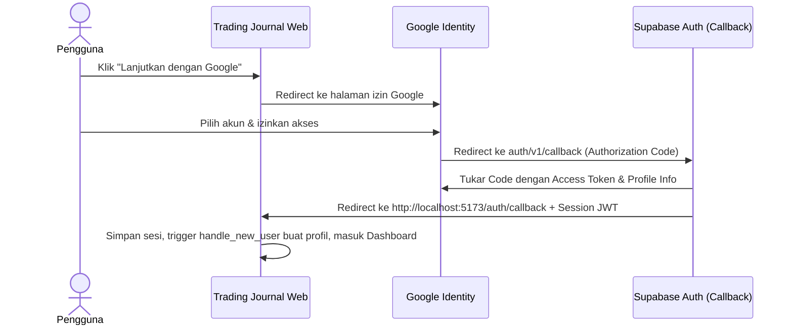

# Panduan Integrasi Google Cloud OAuth 2.0 — Trading Journal

Panduan ini menjelaskan cara mengonfigurasi **Google OAuth 2.0** agar pengguna dapat melakukan registrasi dan login ke aplikasi **Trading Journal WebAPK** hanya dengan satu klik menggunakan akun Google mereka.

---

## Alur Kerja Integrasi



---

## Langkah 1: Siapkan Google Cloud Console

1. Buka [Google Cloud Console](https://console.cloud.google.com/).
2. Login menggunakan akun Google Anda.
3. Di bilah atas, klik pemilih proyek (Project Selector), lalu klik **New Project**.
4. Isi **Project name**: `Trading Journal` (atau nama proyek Anda).
5. Klik **Create** dan pastikan proyek baru tersebut aktif terpilih.

---

## Langkah 2: Konfigurasi OAuth Consent Screen

1. Di menu navigasi kiri Google Cloud Console, pilih **APIs & Services** > **OAuth consent screen** (atau **Branding**).
2. Pada **User Type**, pilih **External**, lalu klik **Create**.
3. Isi informasi aplikasi:
   - **App name**: `Trading Journal`
   - **User support email**: Pilih alamat email Anda.
   - **Developer contact information**: Masukkan alamat email Anda.
4. Klik **Save and Continue**.
5. Di bagian **Scopes**, klik **Add or Remove Scopes**, lalu centang:
   - `.../auth/userinfo.email`
   - `.../auth/userinfo.profile`
   - `openid`
6. Klik **Update**, lalu klik **Save and Continue**.
7. Di bagian **Test users** (selama status aplikasi masih "Testing"):
   - Klik **Add Users** dan masukkan alamat email Google yang akan Anda gunakan untuk menguji login.
8. Klik **Save and Continue** hingga selesai dan kembali ke Dashboard.

---

## Langkah 3: Membuat OAuth 2.0 Client ID

1. Di menu navigasi kiri, pilih **APIs & Services** > **Credentials**.
2. Klik tombol **+ Create Credentials** di bagian atas > pilih **OAuth client ID**.
3. Pada opsi **Application type**, pilih **Web application**.
4. Beri nama: `Trading Journal Web Client`.
5. Pada bagian **Authorized JavaScript origins**, tambahkan:
   - `http://localhost:5173`
   - *(Jika nanti sudah deploy, tambahkan domain hosting Anda, misal: `https://myjournal.vercel.app`)*
6. Pada bagian **Authorized redirect URIs** (**SANGAT PENTING**):
   - Format URI Supabase adalah:
     ```
     https://<YOUR-PROJECT-REF>.supabase.co/auth/v1/callback
     ```
   - Contoh: Jika project URL Anda `https://xyzabcdefghijklmnop.supabase.co`, maka masukkan:
     ```
     https://xyzabcdefghijklmnop.supabase.co/auth/v1/callback
     ```
   > [!IMPORTANT]
   > Jangan mengarahkan redirect URI Google ke `localhost:5173` langsung! Google harus mengarahkannya ke endpoint Supabase (`/auth/v1/callback`), lalu Supabase yang akan mengarahkan kembali pengguna ke aplikasi lokal Anda.
7. Klik **Create**.
8. Salin nilai:
   - **Client ID**
   - **Client Secret**

---

## Langkah 4: Hubungkan ke Supabase Dashboard

1. Buka [Supabase Dashboard](https://supabase.com/dashboard) proyek Anda.
2. Di bilah navigasi kiri, buka menu **Authentication** > **Providers**.
3. Gulir ke bawah dan cari provider **Google**.
4. Klik pada provider **Google** untuk membuka panel pengaturannya:
   - Ubah toggle **Enable Google provider** menjadi **ON**.
   - Masukkan **Client ID** yang Anda salin dari Google Cloud.
   - Masukkan **Client Secret** yang Anda salin dari Google Cloud.
5. Klik tombol **Save** di pojok kanan bawah panel.

---

## Langkah 5: Uji Coba Login dengan Google

1. Pastikan server lokal Anda berjalan (`npm run dev`).
2. Buka browser ke `http://localhost:5173/auth/login`.
3. Klik tombol **Lanjutkan dengan Google**.
4. Anda akan diarahkan ke layar pemilihan akun Google.
5. Setelah memilih akun dan mengonfirmasi izin, browser akan otomatis diarahkan kembali ke `http://localhost:5173/auth/callback` lalu langsung masuk ke **Dashboard Trading Journal**.
6. Nama tampilan dan foto profil Google Anda akan otomatis disinkronkan ke profil akun Anda di aplikasi!
