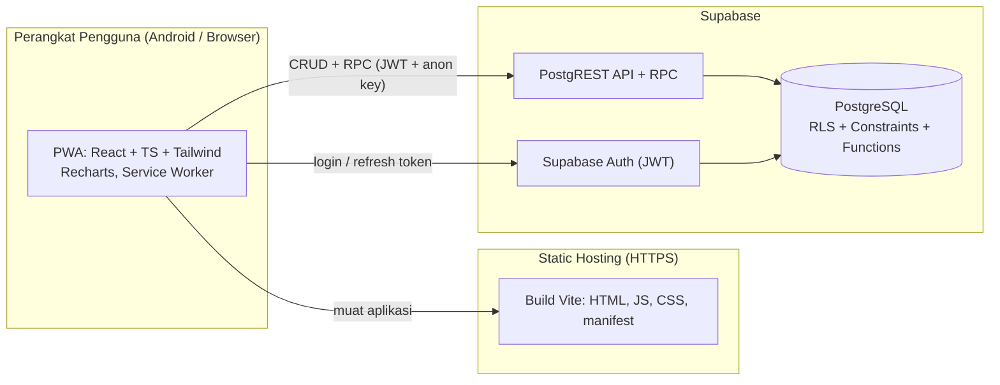
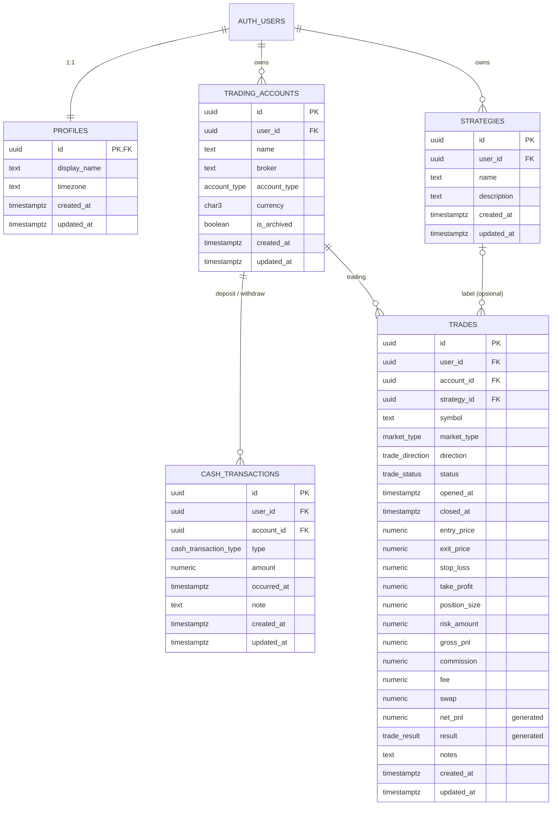
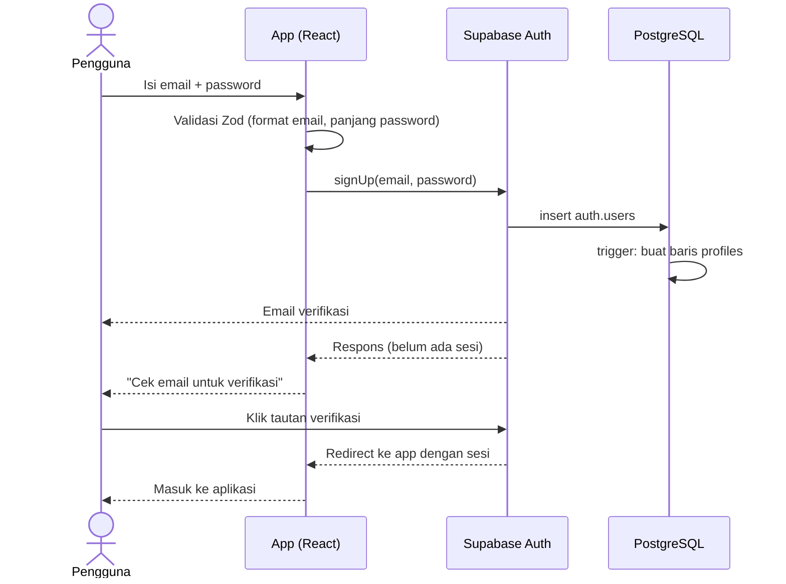
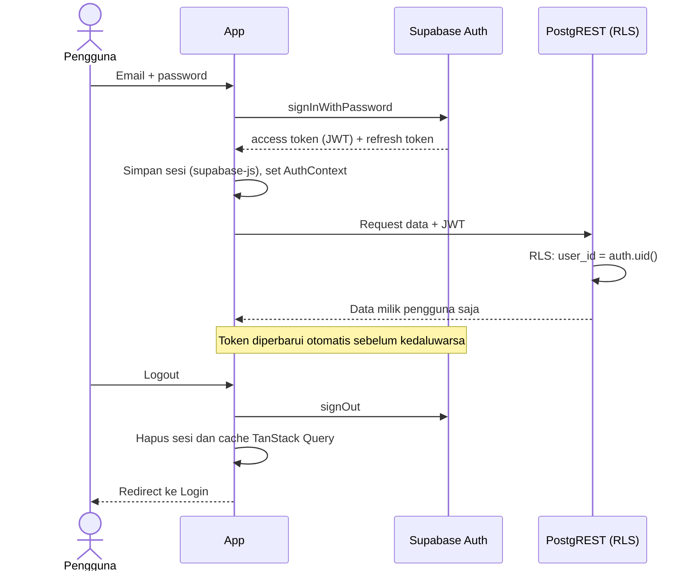

# Trading Journal WebAPK — Phase 00: Project Planning

| | |
|---|---|
| **Versi dokumen** | 1.0 (draft untuk persetujuan) |
| **Tanggal** | 23 November 2026 |
| **Lokasi di repo** | `docs/PHASE_00_PROJECT_PLAN.md` |
| **Status** | Menunggu persetujuan. Phase 01 belum dimulai. |
| **Prioritas keputusan** | Functionality > Data Accuracy > Security > Performance > UI/UX |

## Ringkasan

Trading Journal WebAPK adalah aplikasi PWA (dapat dipasang sebagai WebAPK di Android) untuk mencatat transaksi trading, mengelola arus kas akun, dan menganalisis performa secara akurat.

Tiga aturan domain yang mengikat seluruh dokumen ini:

1. **Deposit dan Withdraw adalah arus kas, bukan hasil trading.** Keduanya disimpan di tabel terpisah (`cash_transactions`) dan tidak pernah masuk ke P/L, winrate, profit factor, expectancy, maupun drawdown.
2. **Winrate hanya dihitung dari trade closed berhasil Win atau Loss.** Breakeven, trade open, dan arus kas dikecualikan.
3. **Semua rumus keuangan didefinisikan satu kali** (Lampiran A) dan dihitung di PostgreSQL sebagai satu-satunya sumber kebenaran. Frontend hanya menampilkan.

Keputusan yang membutuhkan persetujuan Anda dikumpulkan di **Lampiran B**.

## Daftar Isi

1. Product Requirement Document
2. Functional Requirements
3. Non-Functional Requirements
4. System Architecture
5. Database Schema PostgreSQL
6. ERD
7. Struktur Folder Proyek
8. Authentication Flow
9. Security Architecture
10. Development Roadmap
- Lampiran A: Rumus Keuangan dan Contoh Perhitungan
- Lampiran B: Keputusan dan Pertanyaan Terbuka
- Lampiran C: Daftar Dependency yang Diusulkan

---

## 1. Product Requirement Document

### 1.1 Latar Belakang dan Masalah

Trader ritel biasanya mencatat transaksi di spreadsheet atau catatan terpisah. Masalah yang umum terjadi:

- Deposit dan withdraw bercampur dengan hasil trading, sehingga P/L, winrate, dan kurva ekuitas menyesatkan.
- Rumus tidak konsisten antar sheet atau antar periode.
- Pencatatan sulit dilakukan dari ponsel tepat setelah trade selesai.
- Tidak ada evaluasi objektif (profit factor, expectancy, drawdown) untuk memperbaiki strategi.

### 1.2 Tujuan Produk

| ID | Tujuan |
|---|---|
| G-01 | Mencatat trade, deposit, dan withdraw dengan cepat dari ponsel. |
| G-02 | Memisahkan secara tegas hasil trading dan arus kas. |
| G-03 | Menyajikan statistik yang akurat dan konsisten (satu definisi per metrik). |
| G-04 | Dapat dipasang sebagai aplikasi (WebAPK) dan terasa ringan. |
| G-05 | Data tiap pengguna terisolasi dan aman. |

### 1.3 Target Pengguna

- **Persona utama:** trader ritel individu (forex, kripto, saham, atau lainnya) yang trading dari ponsel dan ingin mengevaluasi performanya.
- **Skala awal:** pengguna individu, banyak akun per pengguna (real/demo), tanpa fitur tim.

### 1.4 Ruang Lingkup

**Dalam lingkup (MVP):**

- Autentikasi email dan password (Supabase Auth).
- Banyak akun trading per pengguna, masing-masing satu mata uang.
- Pencatatan deposit dan withdraw.
- Pencatatan trade (open dan closed) dengan biaya (commission, fee, swap).
- Strategi (label buatan pengguna) pada trade.
- Dashboard: saldo, P/L, winrate, profit factor, expectancy, drawdown, equity curve, kinerja per bulan dan per simbol.
- Filter periode dan akun.
- Ekspor CSV.
- PWA: installable, app shell offline, prompt pembaruan.

**Di luar lingkup (MVP):**

- Koneksi otomatis ke broker atau impor otomatis dari MT4/MT5.
- Unrealized P/L (posisi terbuka dinilai harga pasar).
- Konversi multi-mata uang dalam satu dashboard.
- Penulisan data offline (antrean sinkronisasi).
- Fitur sosial, tim, atau berbagi jurnal.
- Unggah screenshot trade (kandidat versi berikutnya).
- Notifikasi push.

### 1.5 User Stories

| ID | Sebagai trader, saya ingin... | Agar... |
|---|---|---|
| US-01 | mendaftar dan masuk dengan email | datanya pribadi dan tersimpan aman |
| US-02 | membuat beberapa akun trading | real dan demo tidak tercampur |
| US-03 | mencatat deposit dan withdraw | saldo akurat tanpa mengubah statistik trading |
| US-04 | mencatat trade beserta biayanya | hasil bersih tercatat benar |
| US-05 | melihat winrate dari trade Win/Loss saja | angkanya mencerminkan kualitas trading |
| US-06 | melihat equity curve dan drawdown | memahami risiko dan konsistensi |
| US-07 | menandai trade dengan strategi | membandingkan kinerja antar strategi |
| US-08 | memasang aplikasi di layar utama | membuka dengan cepat seperti aplikasi native |
| US-09 | mengekspor data ke CSV | punya cadangan dan bisa analisis lanjutan |

### 1.5.1 Aturan Domain Inti

| ID | Aturan |
|---|---|
| BR-01 | Deposit dan withdraw hanya ada di `cash_transactions`. Trade hanya ada di `trades`. Tidak ada tabel atau kolom yang mencampur keduanya. |
| BR-02 | Modal awal dicatat sebagai deposit pertama. Tidak ada kolom `initial_balance`, sehingga tidak ada risiko hitung ganda. |
| BR-03 | Hanya trade berstatus `closed` yang memengaruhi saldo dan statistik (realized only). |
| BR-04 | Hasil trade (Win/Loss/Breakeven) diturunkan dari `net_pnl` oleh database, bukan diinput manual. |
| BR-05 | Trade dimasukkan ke periode berdasarkan `closed_at`. Arus kas berdasarkan `occurred_at`. Batas periode memakai zona waktu profil pengguna. |
| BR-06 | Seluruh nilai uang disimpan sebagai `NUMERIC`, tidak pernah `float`. |
| BR-07 | Satu akun memiliki satu mata uang. Dashboard dihitung per akun. |
| BR-08 | Withdraw tidak boleh membuat saldo akun saat ini menjadi negatif (lihat D-07). |

### 1.6 Kriteria Sukses

| Metrik | Target |
|---|---|
| Akurasi | Seluruh metrik di dashboard identik dengan hasil hitung manual pada data uji Lampiran A (selisih 0). |
| Isolasi data | Uji RLS: pengguna A tidak dapat membaca atau mengubah data pengguna B (0 kebocoran). |
| Kecepatan input | Mencatat trade closed dapat diselesaikan dalam kurang dari 60 detik di ponsel. |
| Installability | Lolos kriteria instalasi Chrome Android (manifest, service worker, HTTPS). |

### 1.7 Asumsi dan Risiko

| Tipe | Uraian | Mitigasi |
|---|---|---|
| Asumsi | Pengguna memasukkan P/L kotor (`gross_pnl`) sesuai laporan broker (D-05). | Perhitungan otomatis dari harga ditunda sampai instrumen yang didukung jelas. |
| Asumsi | Pengguna utama berbahasa Indonesia, zona waktu default Asia/Jakarta (D-12). | Zona waktu dapat diubah di profil. |
| Risiko | Rumus berbeda antara frontend dan backend. | Rumus hanya di PostgreSQL; frontend tidak melakukan aritmetika keuangan. |
| Risiko | Kebocoran data antar pengguna. | RLS pada semua tabel, composite FK, uji RLS wajib di Phase 02. |
| Risiko | Presisi angka di JavaScript. | Database memakai `NUMERIC`; frontend hanya memformat. |
| Risiko | Ketergantungan pada Supabase (availability). | Ekspor CSV sebagai cadangan; skema dikelola lewat migrasi SQL di repo. |

---

## 2. Functional Requirements

Prioritas: **M** = Must (wajib MVP), **S** = Should, **C** = Could.

### 2.1 Autentikasi (AUTH)

| ID | Requirement | Prio |
|---|---|---|
| FR-AUTH-01 | Registrasi dengan email dan password. | M |
| FR-AUTH-02 | Verifikasi email sebelum akun dapat dipakai. | M |
| FR-AUTH-03 | Login dan logout. | M |
| FR-AUTH-04 | Reset password lewat email. | M |
| FR-AUTH-05 | Sesi persisten dengan refresh token otomatis. Sesi kedaluwarsa mengarahkan ke login tanpa kehilangan input yang belum disimpan secara diam-diam (pengguna diberi peringatan). | M |
| FR-AUTH-06 | Route guard: halaman aplikasi hanya untuk pengguna login. | M |
| FR-AUTH-07 | Ubah password saat sedang login. | S |
| FR-AUTH-08 | Hapus akun dan seluruh data (membutuhkan Supabase Edge Function karena butuh hak admin). | C |

### 2.2 Akun Trading (ACC)

| ID | Requirement | Prio |
|---|---|---|
| FR-ACC-01 | Membuat akun: nama, broker (opsional), tipe (real/demo), mata uang (kode 3 huruf). | M |
| FR-ACC-02 | Mengubah nama dan broker. Mata uang tidak dapat diubah setelah ada transaksi. | M |
| FR-ACC-03 | Mengarsipkan dan mengaktifkan kembali akun. | M |
| FR-ACC-04 | Menghapus akun hanya jika tidak memiliki trade maupun transaksi kas. | S |
| FR-ACC-05 | Memilih akun aktif; pilihan diingat per perangkat. | M |

### 2.3 Arus Kas (CSH)

| ID | Requirement | Prio |
|---|---|---|
| FR-CSH-01 | Mencatat deposit: akun, jumlah (> 0), waktu, catatan. | M |
| FR-CSH-02 | Mencatat withdraw: akun, jumlah (> 0), waktu, catatan. | M |
| FR-CSH-03 | Mengubah dan menghapus transaksi kas dengan konfirmasi. | M |
| FR-CSH-04 | Riwayat kas dengan filter tanggal dan tipe, serta pagination. | M |
| FR-CSH-05 | Validasi: withdraw tidak boleh membuat saldo negatif (BR-08). | M |
| FR-CSH-06 | Transaksi kas tidak pernah muncul dalam statistik trading (BR-01). | M |
| FR-CSH-07 | Menampilkan total deposit, total withdraw, dan net deposit. | M |

### 2.4 Trade (TRD)

| ID | Requirement | Prio |
|---|---|---|
| FR-TRD-01 | Mencatat trade closed langsung: simbol, jenis pasar, arah (long/short), waktu buka dan tutup, harga masuk dan keluar, ukuran posisi, `gross_pnl`, commission, fee, swap. | M |
| FR-TRD-02 | Mencatat trade open, lalu menutupnya kemudian (mengisi waktu tutup, harga keluar, `gross_pnl`). | M |
| FR-TRD-03 | Mengubah dan menghapus trade dengan konfirmasi. | M |
| FR-TRD-04 | `net_pnl` dan hasil (Win/Loss/Breakeven) dihitung otomatis oleh database; pengguna tidak dapat menginputnya. | M |
| FR-TRD-05 | Stop loss, take profit, dan `risk_amount` opsional. R-multiple dihitung jika `risk_amount` ada. | S |
| FR-TRD-06 | Menautkan trade ke strategi dan menulis catatan. | S |
| FR-TRD-07 | Daftar trade dengan filter (tanggal, simbol, arah, hasil, strategi), urutan, dan pagination. | M |
| FR-TRD-08 | Validasi input: harga dan ukuran > 0, `closed_at` >= `opened_at`, biaya >= 0. Validasi ganda di UI dan database. | M |
| FR-TRD-09 | Trade open tidak dihitung dalam saldo maupun statistik (BR-03). | M |

### 2.5 Strategi (STR)

| ID | Requirement | Prio |
|---|---|---|
| FR-STR-01 | CRUD strategi (nama unik per pengguna, deskripsi opsional). | S |
| FR-STR-02 | Menghapus strategi tidak menghapus trade; tautan strategi pada trade menjadi kosong. | S |

### 2.6 Dashboard dan Analitik (DSH)

| ID | Requirement | Prio |
|---|---|---|
| FR-DSH-01 | Kartu ringkasan: saldo, total deposit, total withdraw, net trading P/L. | M |
| FR-DSH-02 | Winrate (rumus F-07), jumlah Win, Loss, Breakeven. | M |
| FR-DSH-03 | Profit factor, rata-rata Win, rata-rata Loss, expectancy. | M |
| FR-DSH-04 | Equity curve trading (kumulatif P/L; arus kas tidak ikut). | M |
| FR-DSH-05 | Max drawdown (absolut dan persen). | M |
| FR-DSH-06 | Filter periode (hari ini, 7 hari, 30 hari, bulan ini, kustom, semua). | M |
| FR-DSH-07 | Kinerja per bulan dan per simbol. | S |
| FR-DSH-08 | Kurva saldo (menyertakan arus kas) sebagai grafik tambahan yang diberi label jelas. | S |
| FR-DSH-09 | Kondisi data kosong dan pembagian nol ditampilkan sebagai "N/A", bukan 0. | M |

### 2.7 PWA (PWA)

| ID | Requirement | Prio |
|---|---|---|
| FR-PWA-01 | Dapat dipasang (manifest, ikon, service worker, HTTPS). | M |
| FR-PWA-02 | App shell tersedia offline dengan halaman offline informatif. | S |
| FR-PWA-03 | Prompt saat versi baru tersedia. | S |
| FR-PWA-04 | Data akun tidak di-cache oleh service worker (lihat Bagian 9). | M |

### 2.8 Profil dan Data (PRF)

| ID | Requirement | Prio |
|---|---|---|
| FR-PRF-01 | Profil: nama tampilan dan zona waktu. | M |
| FR-PRF-02 | Ekspor CSV trade dan transaksi kas per akun. | S |

---

## 3. Non-Functional Requirements

| ID | Kategori | Requirement |
|---|---|---|
| NFR-01 | Akurasi | Uang `NUMERIC(18,2)`; harga dan ukuran `NUMERIC(18,8)`. Pembulatan hanya saat tampilan (half away from zero). Frontend tidak melakukan aritmetika keuangan. |
| NFR-02 | Konsistensi | Satu definisi per metrik (Lampiran A), dihitung di database. Data uji Lampiran A menjadi tes otomatis di SQL dan Vitest. |
| NFR-03 | Keamanan | RLS aktif di semua tabel. Tidak ada `service_role` key di klien. Lihat Bagian 9. |
| NFR-04 | Performa | Bundle JS awal <= 200 KB gzip (target). Dashboard memuat < 2 detik di jaringan 4G pada ponsel menengah. List memakai pagination 50 baris. |
| NFR-05 | Skalabilitas data | Index sesuai pola query; sanggup 50.000 trade per akun tanpa degradasi berarti. |
| NFR-06 | Ketersediaan | Mengikuti SLA Supabase. Aplikasi menampilkan status galat yang jelas saat offline atau server tidak terjangkau. |
| NFR-07 | Kompatibilitas | Chrome Android versi terkini (target WebAPK), Chrome/Edge/Safari desktop dan iOS versi terkini sebagai PWA biasa. |
| NFR-08 | UX mobile | Mobile-first, area sentuh >= 44 px, input numerik memakai keyboard numerik. |
| NFR-09 | Aksesibilitas | Kontras WCAG AA, label form, navigasi keyboard. |
| NFR-10 | Maintainability | TypeScript `strict`, ESLint, struktur berbasis fitur, tipe database di-generate dari skema, tanpa kode mati. |
| NFR-11 | Testability | Vitest untuk util dan form; tes SQL untuk rumus dan RLS; checklist uji manual PWA. |
| NFR-12 | Privasi | Data hanya dapat diakses pemiliknya. Pengguna dapat mengekspor data (dan menghapus akun, C). |
| NFR-13 | Pencadangan | Mengandalkan backup Supabase sesuai paket yang dipakai, ditambah ekspor CSV oleh pengguna. |
| NFR-14 | Observabilitas | Galat ditampilkan ke pengguna dengan pesan jelas; log konsol dibersihkan pada build produksi. |
| NFR-15 | Lokalisasi | UI berbahasa Indonesia; format angka dan tanggal via `Intl` mengikuti locale `id-ID` (D-15). |

---

## 4. System Architecture

### 4.1 Gambaran Umum



Prinsip arsitektur:

- **SPA tanpa server sendiri.** Seluruh logika server berada di Supabase (Auth, PostgREST, fungsi SQL). Tidak ada backend kustom di MVP.
- **Database sebagai sumber kebenaran.** Constraint, kolom generated, dan fungsi agregat memastikan data dan rumus konsisten, apa pun klien yang mengaksesnya.
- **Keamanan di lapisan data.** Isolasi pengguna ditegakkan RLS, bukan oleh kode frontend.

### 4.2 Arsitektur Frontend (berlapis)

```
UI Components (Tailwind)         presentational, tanpa akses data
        |
Feature Hooks (TanStack Query)   cache, loading/error state, invalidasi
        |
Feature API modules              satu-satunya tempat yang memanggil Supabase
        |
Supabase Client (src/lib)        satu instance, tipe dari database.ts
```

Aturan:

1. Komponen tidak memanggil Supabase langsung.
2. Tidak ada rumus keuangan di frontend. Metrik datang dari fungsi SQL.
3. Validasi form dengan Zod mencerminkan constraint database (database tetap menjadi penjaga terakhir).
4. State server dikelola TanStack Query. State UI lokal memakai React state/context. Tidak memakai library state global tambahan.

### 4.3 Pembagian Perhitungan

| Lapisan | Tanggung jawab |
|---|---|
| PostgreSQL (kolom generated) | `net_pnl`, `result` per trade |
| PostgreSQL (fungsi SQL, `SECURITY INVOKER`) | Saldo, winrate, profit factor, expectancy, drawdown, equity curve, agregasi per bulan/simbol |
| Frontend | Format tampilan (`Intl`), grafik, pratinjau `net_pnl` di form (hanya estimasi; nilai resmi dari database) |

### 4.4 Fungsi Database yang Direncanakan

Semua `STABLE`, `LANGUAGE sql`, `SECURITY INVOKER` sehingga RLS tetap berlaku.

| Fungsi | Keluaran |
|---|---|
| `get_account_summary(p_account_id, p_from, p_to, p_tz)` | Total deposit/withdraw/net deposit dan saldo (kumulatif s.d. `p_to`), serta metrik kinerja periode: P/L, jumlah Win/Loss/BE, winrate, total win/loss amount, avg win/loss, profit factor, expectancy, avg R, return on deposits, max drawdown abs/persen |
| `get_equity_curve(p_account_id, p_from, p_to)` | Deret titik (`closed_at`, `net_pnl`, `cumulative_pnl`, `drawdown`) |
| `get_balance_curve(p_account_id, p_from, p_to)` | Deret saldo harian termasuk arus kas |
| `get_monthly_performance(p_account_id, p_from, p_to, p_tz)` | P/L, jumlah trade, winrate per bulan |
| `get_symbol_performance(p_account_id, p_from, p_to)` | P/L, jumlah trade, winrate per simbol |

### 4.5 Strategi PWA dan Offline

- `vite-plugin-pwa` dengan service worker yang meng-cache **app shell saja** (HTML, JS, CSS, ikon).
- Panggilan ke `*.supabase.co` **tidak di-cache** (data keuangan dan token tidak boleh tersimpan di cache SW).
- Tidak ada penulisan data offline (D-08). Saat offline, UI menonaktifkan tombol simpan dan menampilkan penjelasan. Ini menghindari konflik data dan menjaga akurasi.
- Update memakai mode prompt agar pengguna tidak kehilangan input form saat versi baru aktif.

### 4.6 Lingkungan

| Lingkungan | Keterangan |
|---|---|
| Local | Vite dev server + Supabase project pengembangan (atau Supabase CLI lokal) |
| Production | Static hosting HTTPS (D-14) + Supabase project produksi |
| Konfigurasi | `.env.local` berisi `VITE_SUPABASE_URL` dan `VITE_SUPABASE_ANON_KEY`; `.env.example` di-commit, `.env.local` tidak |

---

## 5. Database Schema PostgreSQL

> Status: **DRAFT desain**. SQL di bawah belum dijalankan. Skema final divalidasi dan diuji di Phase 02 sebelum menjadi migrasi di `supabase/migrations/`. Target PostgreSQL 15+ (versi Supabase saat ini), karena memakai `ON DELETE SET NULL (kolom)`.

### 5.1 Ringkasan Tabel

| Tabel | Fungsi |
|---|---|
| `profiles` | Data profil 1:1 dengan `auth.users` |
| `trading_accounts` | Akun trading milik pengguna (satu mata uang per akun) |
| `strategies` | Strategi buatan pengguna |
| `cash_transactions` | **Hanya** deposit dan withdraw |
| `trades` | **Hanya** transaksi trading |

Prinsip integritas:

- Setiap tabel domain membawa `user_id` untuk RLS yang sederhana dan cepat.
- **Composite FK `(account_id, user_id)`** memastikan trade atau transaksi kas tidak dapat menunjuk akun milik pengguna lain, walaupun RLS bocor atau salah konfigurasi.
- `ON DELETE NO ACTION` (default) dari tabel anak ke akun: akun tidak bisa dihapus selama masih punya data, tetapi penghapusan pengguna (cascade dari `auth.users`) tetap berjalan karena pemeriksaan ditunda sampai akhir statement.

### 5.2 Tipe Enum

```sql
create type public.account_type          as enum ('real', 'demo');
create type public.market_type           as enum ('forex', 'crypto', 'stock', 'index', 'commodity', 'other');
create type public.trade_direction       as enum ('long', 'short');
create type public.trade_status          as enum ('open', 'closed');
create type public.trade_result          as enum ('win', 'loss', 'breakeven');
create type public.cash_transaction_type as enum ('deposit', 'withdraw');
```

### 5.3 Fungsi Pembantu

```sql
create function public.set_updated_at()
returns trigger
language plpgsql
as $$
begin
  new.updated_at = now();
  return new;
end;
$$;

create function public.handle_new_user()
returns trigger
language plpgsql
security definer
set search_path = ''
as $$
begin
  insert into public.profiles (id) values (new.id);
  return new;
end;
$$;
```

### 5.4 Tabel

```sql
-- 1) profiles
create table public.profiles (
  id           uuid primary key references auth.users (id) on delete cascade,
  display_name text check (display_name is null or char_length(display_name) <= 80),
  timezone     text not null default 'Asia/Jakarta',
  created_at   timestamptz not null default now(),
  updated_at   timestamptz not null default now()
);

create trigger on_auth_user_created
  after insert on auth.users
  for each row execute function public.handle_new_user();

-- 2) trading_accounts
create table public.trading_accounts (
  id           uuid primary key default gen_random_uuid(),
  user_id      uuid not null references auth.users (id) on delete cascade,
  name         text not null check (char_length(name) between 1 and 80),
  broker       text check (broker is null or char_length(broker) <= 80),
  account_type public.account_type not null default 'real',
  currency     char(3) not null check (currency = upper(currency)),
  is_archived  boolean not null default false,
  created_at   timestamptz not null default now(),
  updated_at   timestamptz not null default now(),
  unique (id, user_id),
  unique (user_id, name)
);

-- 3) strategies
create table public.strategies (
  id          uuid primary key default gen_random_uuid(),
  user_id     uuid not null references auth.users (id) on delete cascade,
  name        text not null check (char_length(name) between 1 and 60),
  description text check (description is null or char_length(description) <= 500),
  created_at  timestamptz not null default now(),
  updated_at  timestamptz not null default now(),
  unique (id, user_id),
  unique (user_id, name)
);

-- 4) cash_transactions  (HANYA deposit/withdraw, terpisah dari trades)
create table public.cash_transactions (
  id          uuid primary key default gen_random_uuid(),
  user_id     uuid not null references auth.users (id) on delete cascade,
  account_id  uuid not null,
  type        public.cash_transaction_type not null,
  amount      numeric(18,2) not null check (amount > 0),   -- selalu positif; arah ditentukan oleh type
  occurred_at timestamptz not null,
  note        text check (note is null or char_length(note) <= 500),
  created_at  timestamptz not null default now(),
  updated_at  timestamptz not null default now(),
  constraint cash_transactions_account_fk
    foreign key (account_id, user_id)
    references public.trading_accounts (id, user_id)
);

-- 5) trades  (HANYA transaksi trading)
create table public.trades (
  id            uuid primary key default gen_random_uuid(),
  user_id       uuid not null references auth.users (id) on delete cascade,
  account_id    uuid not null,
  strategy_id   uuid,
  symbol        text not null check (char_length(symbol) between 1 and 30),
  market_type   public.market_type not null default 'other',
  direction     public.trade_direction not null,
  status        public.trade_status not null default 'open',
  opened_at     timestamptz not null,
  closed_at     timestamptz,
  entry_price   numeric(18,8) not null check (entry_price > 0),
  exit_price    numeric(18,8) check (exit_price > 0),
  stop_loss     numeric(18,8) check (stop_loss > 0),
  take_profit   numeric(18,8) check (take_profit > 0),
  position_size numeric(18,8) not null check (position_size > 0),
  risk_amount   numeric(18,2) check (risk_amount > 0),
  gross_pnl     numeric(18,2),
  commission    numeric(18,2) not null default 0 check (commission >= 0),  -- biaya, >= 0
  fee           numeric(18,2) not null default 0 check (fee >= 0),         -- biaya, >= 0
  swap          numeric(18,2) not null default 0,                          -- bertanda: negatif = biaya

  -- F-01: net_pnl = gross_pnl - commission - fee + swap
  net_pnl       numeric(18,2)
                generated always as (gross_pnl - commission - fee + swap) stored,

  -- F-02: hasil diturunkan dari net_pnl (rumus diulang karena kolom generated
  -- tidak boleh merujuk kolom generated lain)
  result        public.trade_result
                generated always as (
                  case
                    when status = 'closed' and gross_pnl is not null then
                      case
                        when (gross_pnl - commission - fee + swap) > 0 then 'win'::public.trade_result
                        when (gross_pnl - commission - fee + swap) < 0 then 'loss'::public.trade_result
                        else 'breakeven'::public.trade_result
                      end
                  end
                ) stored,

  notes         text check (notes is null or char_length(notes) <= 2000),
  created_at    timestamptz not null default now(),
  updated_at    timestamptz not null default now(),

  constraint trades_account_fk
    foreign key (account_id, user_id)
    references public.trading_accounts (id, user_id),

  constraint trades_strategy_fk
    foreign key (strategy_id, user_id)
    references public.strategies (id, user_id)
    on delete set null (strategy_id),

  constraint trades_state_consistency check (
    (status = 'open'
      and closed_at is null and exit_price is null and gross_pnl is null)
    or
    (status = 'closed'
      and closed_at is not null and exit_price is not null and gross_pnl is not null
      and closed_at >= opened_at)
  )
);
```

### 5.5 Index

```sql
create index trades_account_closed_idx on public.trades (account_id, closed_at desc) where status = 'closed';
create index trades_user_account_opened_idx on public.trades (user_id, account_id, opened_at desc);
create index trades_symbol_idx on public.trades (account_id, symbol);
create index trades_strategy_idx on public.trades (strategy_id) where strategy_id is not null;
create index cash_account_occurred_idx on public.cash_transactions (account_id, occurred_at desc);
create index accounts_user_idx on public.trading_accounts (user_id);
```

### 5.6 Trigger `updated_at`

```sql
create trigger set_updated_at before update on public.profiles
  for each row execute function public.set_updated_at();
create trigger set_updated_at before update on public.trading_accounts
  for each row execute function public.set_updated_at();
create trigger set_updated_at before update on public.strategies
  for each row execute function public.set_updated_at();
create trigger set_updated_at before update on public.cash_transactions
  for each row execute function public.set_updated_at();
create trigger set_updated_at before update on public.trades
  for each row execute function public.set_updated_at();
```

### 5.7 Row Level Security (pola, berlaku untuk semua tabel)

```sql
alter table public.trades enable row level security;
revoke all on public.trades from anon;

create policy trades_select_own on public.trades
  for select to authenticated
  using (user_id = (select auth.uid()));

create policy trades_insert_own on public.trades
  for insert to authenticated
  with check (user_id = (select auth.uid()));

create policy trades_update_own on public.trades
  for update to authenticated
  using (user_id = (select auth.uid()))
  with check (user_id = (select auth.uid()));

create policy trades_delete_own on public.trades
  for delete to authenticated
  using (user_id = (select auth.uid()));
```

Untuk `profiles`, kondisi memakai `id = (select auth.uid())`. Pola yang sama diterapkan pada `trading_accounts`, `strategies`, dan `cash_transactions`.

### 5.7.1 Aturan yang Ditegakkan Trigger (dirancang di Phase 02/05)

| Aturan | Penegakan |
|---|---|
| Mata uang akun tidak dapat diubah jika sudah ada trade atau transaksi kas | Trigger `BEFORE UPDATE` pada `trading_accounts` |
| Withdraw tidak boleh membuat saldo saat ini negatif (BR-08, D-07) | Trigger pada `cash_transactions` (insert/update/delete) yang memeriksa saldo dengan rumus F-05 |
| `user_id` tidak dapat diubah setelah baris dibuat | Trigger `BEFORE UPDATE` pada semua tabel domain |

### 5.8 Dampak Perubahan Skema

Phase 00 hanya merancang skema. Tidak ada database yang diubah. Mulai Phase 02, setiap perubahan struktur dilakukan lewat file migrasi baru dengan penjelasan dampak (data existing, constraint, RLS, kebutuhan regenerasi tipe TypeScript).

---

## 6. ERD



Versi teks (jika viewer tidak mendukung Mermaid):

| Relasi | Kardinalitas | Kunci | Aksi hapus |
|---|---|---|---|
| `auth.users` → `profiles` | 1 : 1 | `profiles.id` | CASCADE |
| `auth.users` → `trading_accounts` | 1 : N | `user_id` | CASCADE |
| `auth.users` → `strategies` | 1 : N | `user_id` | CASCADE |
| `trading_accounts` → `cash_transactions` | 1 : N | `(account_id, user_id)` | NO ACTION |
| `trading_accounts` → `trades` | 1 : N | `(account_id, user_id)` | NO ACTION |
| `strategies` → `trades` | 1 : N (opsional) | `(strategy_id, user_id)` | SET NULL `(strategy_id)` |

Catatan: tidak ada relasi antara `cash_transactions` dan `trades`. Pemisahan ini disengaja (BR-01).

---

## 7. Struktur Folder Proyek

```
trading-journal/
├─ PROJECT_STATUS.md
├─ README.md
├─ package.json
├─ tsconfig.json
├─ vite.config.ts                  # React plugin + vite-plugin-pwa
├─ tailwind.config.ts
├─ postcss.config.js
├─ eslint.config.js
├─ index.html
├─ .env.example                    # contoh variabel; .env.local tidak di-commit
├─ .gitignore
├─ docs/
│  └─ PHASE_00_PROJECT_PLAN.md
├─ supabase/
│  ├─ config.toml
│  ├─ migrations/                  # skema, RLS, trigger, fungsi (berurutan)
│  └─ tests/                       # tes SQL: rumus Lampiran A dan RLS
├─ public/
│  └─ icons/                       # ikon PWA 192, 512, maskable
└─ src/
   ├─ main.tsx
   ├─ app/
   │  ├─ App.tsx
   │  ├─ router.tsx                # rute publik dan terlindungi
   │  └─ providers.tsx             # QueryClient, AuthProvider
   ├─ components/
   │  ├─ ui/                       # Button, Input, Card, Modal, Toast, EmptyState
   │  └─ layout/                   # AppShell, BottomNav, PageHeader
   ├─ features/
   │  ├─ auth/                     # api, hooks, pages (Login, Register, Reset), AuthGuard
   │  ├─ accounts/                 # api, hooks, components, schema.ts (Zod)
   │  ├─ cash/                     # deposit/withdraw (terpisah dari trades)
   │  ├─ trades/                   # api, hooks, components, schema.ts
   │  ├─ strategies/
   │  ├─ dashboard/                # pemanggil fungsi SQL + chart Recharts
   │  └─ settings/                 # profil, zona waktu, ekspor
   ├─ lib/
   │  ├─ supabase.ts               # satu klien Supabase
   │  ├─ env.ts                    # validasi variabel lingkungan
   │  ├─ format.ts                 # Intl: uang, persen, tanggal
   │  └─ errors.ts                 # pemetaan galat database ke pesan pengguna
   ├─ hooks/                       # hook umum (mis. useOnlineStatus)
   ├─ types/
   │  └─ database.ts               # hasil `supabase gen types typescript`
   └─ styles/
      └─ index.css                 # direktif Tailwind
```

Aturan struktur:

- Satu fitur = satu folder berisi `api`, `hooks`, `components`, `schema`. Fitur tidak mengimpor internal fitur lain; berbagi lewat `components/`, `lib/`, atau `types/`.
- `features/cash` dan `features/trades` sengaja terpisah untuk mencerminkan BR-01.
- Hanya `*/api.ts` dan `lib/supabase.ts` yang boleh menyentuh klien Supabase.

---

## 8. Authentication Flow

Metode MVP: **email + password** via Supabase Auth. Login pihak ketiga (mis. Google) tidak termasuk MVP (Q-03).

### 8.1 Registrasi dan Verifikasi Email



### 8.2 Login, Sesi, dan Logout



### 8.3 Reset Password

1. Pengguna memasukkan email di halaman "Lupa password".
2. App memanggil `resetPasswordForEmail`; respons selalu netral ("Jika email terdaftar, tautan dikirim") untuk mencegah enumerasi akun.
3. Tautan membuka halaman "Password baru" dalam mode recovery.
4. App memanggil `updateUser({ password })`, lalu mengarahkan ke login.

### 8.4 Route Guard dan Kondisi Khusus

| Kondisi | Perilaku |
|---|---|
| Belum login membuka halaman terlindungi | Redirect ke `/login`, tujuan semula diingat |
| Sudah login membuka `/login` | Redirect ke dashboard |
| Status sesi masih dimuat | Tampilkan layar loading; tidak ada kilasan konten terlindungi |
| Refresh token gagal atau sesi dicabut | Pengguna diberi pesan dan diarahkan ke login |
| Email belum diverifikasi | Login ditolak dengan pesan yang jelas dan opsi kirim ulang |
| Offline saat membuka aplikasi | App shell tampil; sesi yang tersimpan dikenali, panggilan data menampilkan status offline |

### 8.5 Kebijakan Password

Minimal 8 karakter (batas dikonfigurasi di dashboard Supabase Auth). Validasi di UI hanya membantu pengguna; penegakan ada di Supabase Auth.

---

## 9. Security Architecture

### 9.1 Model Ancaman dan Kontrol

| Ancaman | Kontrol |
|---|---|
| Pengguna A membaca data pengguna B | RLS pada semua tabel dengan `user_id = auth.uid()`; composite FK mencegah referensi lintas pengguna; tes RLS wajib (Phase 02 dan 10) |
| Anon key terlihat di klien | Diharapkan (key publik). Keamanan bergantung pada RLS, bukan kerahasiaan key. Hak `anon` dicabut dari semua tabel |
| `service_role` key bocor | Tidak pernah dipakai di frontend atau repo. Jika Edge Function dibutuhkan (hapus akun), key hanya di secret Supabase |
| XSS mencuri token (supabase-js menyimpan sesi di localStorage) | React meng-escape output; dilarang `dangerouslySetInnerHTML`; Content-Security-Policy ketat (tanpa inline script, sumber dibatasi ke origin sendiri dan Supabase); dependency minimal; `npm audit` rutin |
| Data keuangan tersimpan di cache service worker | SW hanya cache app shell; request ke Supabase tidak di-cache; cache dibersihkan saat logout |
| Manipulasi nilai oleh klien | Constraint CHECK, kolom generated, dan trigger di database; klien tidak bisa menulis `net_pnl` atau `result` |
| SQL injection | Semua akses lewat PostgREST/RPC berparameter; tidak ada SQL dinamis dari input pengguna |
| Fungsi `SECURITY DEFINER` disalahgunakan | Dipakai hanya untuk `handle_new_user` dengan `set search_path = ''`; fungsi analitik memakai `SECURITY INVOKER` |
| Brute force login, spam registrasi | Rate limit bawaan Supabase Auth; CAPTCHA opsional jika diperlukan |
| Enumerasi akun | Pesan reset password netral |
| Kehilangan data karena salah hapus | Dialog konfirmasi; `NO ACTION` mencegah hapus akun yang berisi data; ekspor CSV |
| Secret masuk repo | `.env.local` di `.gitignore`; hanya `.env.example` di-commit |
| Transport | HTTPS wajib (syarat PWA); HSTS di hosting |

### 9.2 Header dan Hosting

- `Content-Security-Policy`, `X-Content-Type-Options: nosniff`, `Referrer-Policy: strict-origin-when-cross-origin`, `Permissions-Policy` minimal.
- Header dikonfigurasi di platform hosting (diputuskan di Phase 01, D-14).

### 9.3 Pengujian Keamanan

| Uji | Fase |
|---|---|
| Tes SQL: pengguna A tidak bisa select/insert/update/delete data pengguna B di semua tabel | 02 |
| Tes SQL: insert trade ke akun milik pengguna lain ditolak (composite FK) | 02 |
| Tes SQL: `anon` tidak bisa mengakses tabel apa pun | 02 |
| Uji manual: SW tidak menyimpan respons API (DevTools > Cache Storage) | 09 |
| Review akhir: `npm audit`, pemeriksaan CSP, pemeriksaan bundle tanpa secret | 10 |

---

## 10. Development Roadmap

Aturan eksekusi: satu fase pada satu waktu, setiap fase diakhiri uji, pembaruan `PROJECT_STATUS.md`, dan menunggu persetujuan Anda. Roadmap ini merinci usulan awal (7 langkah) menjadi 10 fase agar tiap fase kecil dan dapat diuji.

| Fase | Nama | Output utama |
|---|---|---|
| 00 | Project Planning | Dokumen ini + `PROJECT_STATUS.md` |
| 01 | Foundation | Scaffold Vite + React + TS, Tailwind, router, struktur folder, klien Supabase, validasi env, ESLint, Vitest, `.env.example` |
| 02 | Database dan RLS | Migrasi skema, trigger, RLS, fungsi analitik, tes SQL (rumus + RLS), generate tipe TS |
| 03 | Autentikasi | Register, login, logout, reset password, AuthGuard, profil otomatis |
| 04 | Akun Trading dan Profil | CRUD akun, arsip, akun aktif, profil dan zona waktu |
| 05 | Arus Kas | Deposit/withdraw, riwayat, validasi saldo, total kas |
| 06 | Jurnal Trade | CRUD trade (open/closed), biaya, validasi, daftar dengan filter dan pagination |
| 07 | Dashboard dan Analitik | Kartu ringkasan, winrate, profit factor, expectancy, equity curve, drawdown, per bulan/simbol |
| 08 | Strategi dan Ekspor | CRUD strategi, tautan ke trade, statistik per strategi, ekspor CSV |
| 09 | PWA | Manifest, ikon, service worker, halaman offline, prompt update, uji instalasi WebAPK |
| 10 | QA dan Rilis | Regresi penuh, audit keamanan, performa, perbaikan bug, dokumentasi, deploy produksi |

### Kriteria Selesai Tiap Fase (Definition of Done)

1. Seluruh fitur fase berfungsi nyata (tanpa placeholder atau data dummy).
2. Tes fase lulus (unit, SQL, dan/atau manual sesuai langkah di laporan fase).
3. Tidak ada error TypeScript maupun ESLint; `npm run build` berhasil.
4. Konsistensi antarfile dan import diperiksa.
5. Perubahan skema (jika ada) disertai penjelasan dampak.
6. `PROJECT_STATUS.md` diperbarui: fitur selesai, belum selesai, bug, keputusan teknis, pekerjaan berikutnya.

### Rincian Fase

**Fase 01 Foundation.** Uji: `npm run dev` dan `npm run build` sukses, rute dasar tampil, env tervalidasi (error jelas bila variabel kosong).

**Fase 02 Database dan RLS.** Uji: semua kasus di Lampiran A lulus di SQL; seluruh tes RLS (9.3) lulus; deposit/withdraw tidak memengaruhi metrik trading; winrate hanya Win/Loss. Ini fase dengan risiko akurasi tertinggi sehingga mendapat porsi uji terbesar.

**Fase 03 Autentikasi.** Uji: alur di Bagian 8 (registrasi, verifikasi, login, logout, reset, guard, sesi kedaluwarsa).

**Fase 04 Akun Trading.** Uji: validasi mata uang, unik nama, arsip, hapus hanya jika kosong, mata uang terkunci setelah ada transaksi.

**Fase 05 Arus Kas.** Uji: withdraw melebihi saldo ditolak; edit/hapus kas memperbarui saldo; statistik trading tidak berubah saat kas berubah.

**Fase 06 Jurnal Trade.** Uji: constraint open/closed, `net_pnl` dan `result` otomatis, filter dan pagination, edit trade mengubah hasil secara konsisten.

**Fase 07 Dashboard.** Uji: angka dashboard sama dengan Lampiran A; kondisi kosong menampilkan "N/A"; ganti periode dan zona waktu menghasilkan batas yang benar.

**Fase 08 Strategi dan Ekspor.** Uji: hapus strategi tidak menghapus trade; isi CSV sama dengan data di database.

**Fase 09 PWA.** Uji: Lighthouse PWA, instalasi di Chrome Android (WebAPK), mode offline, prompt update, SW tidak meng-cache respons Supabase.

**Fase 10 QA dan Rilis.** Uji: regresi seluruh fase, audit RLS ulang, `npm audit`, anggaran bundle, uji di minimal satu ponsel Android nyata.

---

## Lampiran A: Rumus Keuangan dan Contoh Perhitungan

Seluruh rumus dihitung di PostgreSQL dengan `NUMERIC`. Kode frontend, laporan, dan ekspor mengacu pada definisi ini.

### A.1 Definisi

| ID | Metrik | Rumus |
|---|---|---|
| F-01 | Net P/L per trade | `net_pnl = gross_pnl − commission − fee + swap` (commission dan fee >= 0 sebagai biaya; swap bertanda, negatif = biaya) |
| F-02 | Hasil trade | `win` jika `net_pnl > 0`; `loss` jika `net_pnl < 0`; `breakeven` jika `net_pnl = 0`; kosong jika trade masih open |
| F-03 | Arus kas | `total_deposit = Σ amount (type = deposit)`; `total_withdraw = Σ amount (type = withdraw)`; `net_deposit = total_deposit − total_withdraw` |
| F-04 | Trading P/L | `trading_pnl = Σ net_pnl` untuk trade closed |
| F-05 | Saldo | `balance = net_deposit + trading_pnl` (kumulatif sejak awal sampai batas akhir periode; trade open tidak dihitung) |
| F-06 | Performance Set (PS) | Trade closed berhasil `win` atau `loss` pada periode. Seluruh metrik rata-rata dan rasio di bawah memakai PS. Breakeven hanya dihitung sebagai jumlah. |
| F-07 | Winrate | `winrate = wins / (wins + losses) × 100`; kosong (N/A) jika `wins + losses = 0` |
| F-08 | Total Win / Loss | `total_win_amount = Σ net_pnl (win)`; `total_loss_amount = Σ |net_pnl| (loss)` (nilai positif) |
| F-09 | Rata-rata | `avg_win = total_win_amount / wins`; `avg_loss = total_loss_amount / losses`; N/A jika penyebut 0 |
| F-10 | Profit factor | `profit_factor = total_win_amount / total_loss_amount`; N/A jika `total_loss_amount = 0` |
| F-11 | Expectancy | `expectancy = (total_win_amount − total_loss_amount) / (wins + losses)`. Setara dengan `winrate × avg_win − (1 − winrate) × avg_loss` |
| F-12 | R-multiple | `r = net_pnl / risk_amount` per trade; `avg_r` = rata-rata `r` pada PS dengan `risk_amount` terisi |
| F-13 | Return on deposits | `return_pct = trading_pnl / total_deposit × 100`; N/A jika `total_deposit = 0` (v1, lihat D-10) |
| F-14 | Equity curve | Titik awal 0. Urutkan trade closed berdasarkan `closed_at` (tie-break `created_at`, `id`). `cumulative_pnl_i = Σ net_pnl` sampai trade ke-i. Arus kas tidak ikut. |
| F-15 | Drawdown | `peak_i = max(0, cumulative_pnl_1..i)`; `dd_i = peak_i − cumulative_pnl_i`; `max_drawdown_abs = max(dd_i)`. Persen: `dd_pct_i = dd_i / (deposit_kumulatif_pada_waktu_peak_i + peak_i)`, `max_drawdown_pct = max(dd_pct_i) × 100`; N/A jika penyebut <= 0 (D-09) |
| F-16 | Pembulatan | Hitung penuh dalam `NUMERIC`; bulatkan hanya saat tampilan: uang 2 desimal, persen 2 desimal, rasio 2 desimal, half away from zero |
| F-17 | Periode | Trade menurut `closed_at`, kas menurut `occurred_at`, batas hari/bulan menurut zona waktu profil. Saldo kumulatif sampai `p_to`; metrik kinerja hanya untuk `[p_from, p_to]` |

### A.2 Contoh Perhitungan (menjadi data uji Fase 02 dan 07)

Satu akun, mata uang USD. Nilai `net_pnl` sudah termasuk biaya.

| # | Waktu | Jenis | Nilai |
|---|---|---|---|
| 1 | 1 Nov | Deposit | 1.000,00 |
| 2 | 2 Nov | Trade closed | +50,00 (Win) |
| 3 | 3 Nov | Trade closed | −30,00 (Loss) |
| 4 | 4 Nov | Withdraw | 200,00 |
| 5 | 5 Nov | Trade closed | 0,00 (Breakeven) |
| 6 | 6 Nov | Trade closed | +80,00 (Win) |
| 7 | 7 Nov | Trade open | (diabaikan) |

Hasil yang benar:

| Metrik | Perhitungan | Hasil |
|---|---|---|
| total_deposit / total_withdraw / net_deposit | 1.000 / 200 / 800 | 1.000,00 / 200,00 / 800,00 |
| trading_pnl | 50 − 30 + 0 + 80 | 100,00 |
| balance | 800 + 100 | **900,00** |
| wins / losses / breakevens | | 2 / 1 / 1 |
| winrate | 2 / (2 + 1) | **66,67%** (kas dan BE tidak ikut) |
| total_win_amount / total_loss_amount | 50 + 80 / 30 | 130,00 / 30,00 |
| avg_win / avg_loss | 130 / 2 ; 30 / 1 | 65,00 / 30,00 |
| profit_factor | 130 / 30 | 4,33 |
| expectancy | (130 − 30) / 3 | 33,33 (cek: 0,6667 × 65 − 0,3333 × 30 = 33,33) |
| return_pct | 100 / 1.000 | 10,00% |
| equity curve (kumulatif) | +50, +20, +20, +100 | titik: 50, 20, 20, 100 |
| max_drawdown_abs | peak 50, trough 20 | 30,00 |
| max_drawdown_pct | 30 / (1.000 + 50) | 2,86% |

Pembuktian pemisahan: menghapus Withdraw #4 hanya mengubah saldo menjadi 1.100,00. Winrate, trading_pnl, profit factor, expectancy, dan drawdown tidak berubah.

### A.3 Kasus Tepi yang Wajib Diuji

| Kasus | Hasil yang diharapkan |
|---|---|
| Belum ada trade closed | Semua rasio N/A, saldo = net_deposit |
| Hanya Win (tanpa Loss) | winrate 100%, profit_factor N/A, avg_loss N/A |
| Hanya Breakeven | winrate N/A (penyebut 0) |
| total_deposit = 0 | return_pct N/A |
| Dua trade closed pada `closed_at` yang sama | Urutan stabil via tie-break |
| Trade di batas tengah malam | Masuk hari sesuai zona waktu profil |
| Edit `gross_pnl`, commission, fee, atau swap | `net_pnl` dan `result` ikut berubah, statistik konsisten |
| Trade diubah dari closed ke open | Kolom penutup dikosongkan, keluar dari statistik |

---

## Lampiran B: Keputusan dan Pertanyaan Terbuka

Keputusan di bawah adalah usulan default saya. Jika tidak ada koreksi, Phase 01 dan seterusnya akan mengikutinya. Keputusan yang sudah Anda tetapkan (stack, aturan proyek, pemisahan deposit/withdraw, aturan winrate) tidak masuk daftar ini.

| ID | Keputusan (default) | Alasan | Dampak jika diubah |
|---|---|---|---|
| D-01 | Satu mata uang per akun; dashboard per akun | Menghindari konversi kurs yang memengaruhi akurasi | Multi-mata uang butuh tabel kurs dan perubahan semua rumus |
| D-02 | Modal awal = deposit pertama; tanpa `initial_balance` | Mencegah hitung ganda | Menambah kolom mengubah F-05 |
| D-03 | Win/Loss ditentukan oleh `net_pnl` (setelah biaya) | Mencerminkan hasil riil | Memakai `gross_pnl` mengubah F-02 dan semua statistik |
| D-04 | Semua agregat dihitung di PostgreSQL | Satu sumber kebenaran | Menghitung di frontend berisiko selisih |
| D-05 | `gross_pnl` diinput manual (angka dari broker); belum ada hitung otomatis dari harga | Rumus P/L bergantung pada instrumen (pip value, contract size, kurs) dan rawan salah | Hitung otomatis bisa ditambah per jenis instrumen pada fase lanjutan |
| D-06 | Hanya realized P/L; tanpa unrealized | Sesuai BR-03; menjaga akurasi | Unrealized butuh harga pasar real-time |
| D-07 | Withdraw yang membuat saldo saat ini negatif ditolak | Mencegah data tidak masuk akal | Jika ingin boleh, hapus trigger dan beri peringatan saja |
| D-08 | Tanpa penulisan offline | Menghindari konflik dan data ganda | Antrean offline butuh strategi sinkronisasi dan resolusi konflik |
| D-09 | Drawdown dihitung pada kurva P/L trading (kas tidak ikut); persen terhadap modal deposit kumulatif saat peak + peak | Withdraw tidak boleh tampak seperti kerugian | Metode lain mengubah F-15 |
| D-10 | Return = trading_pnl / total_deposit | Sederhana dan konsisten | Time-weighted return lebih akurat bila banyak deposit/withdraw, tetapi lebih kompleks |
| D-11 | Hapus bersifat permanen dengan konfirmasi; akun tidak bisa dihapus bila berisi data (arsipkan saja) | Sederhana dan aman | Soft delete + audit log menambah kompleksitas |
| D-12 | Waktu disimpan UTC (`timestamptz`); zona waktu default Asia/Jakarta, dapat diubah di profil | Batas periode benar | Zona waktu default lain cukup mengubah satu nilai |
| D-13 | Dependency sesuai Lampiran C | Minimal dan umum dipakai | Perlu persetujuan sebelum menambah di luar daftar |
| D-14 | Hosting statis HTTPS (kandidat: Vercel, Netlify, Cloudflare Pages); dipilih di Phase 01 | Syarat PWA dan header keamanan | Tidak memengaruhi skema |
| D-15 | UI berbahasa Indonesia saja pada MVP | Menyederhanakan | i18n butuh lapisan terjemahan |

Pertanyaan terbuka:

| ID | Pertanyaan | Default bila tidak dijawab |
|---|---|---|
| Q-01 | Instrumen apa yang dicatat: forex, saham, kripto, atau campuran? | Campuran; field `market_type` tersedia, simbol bebas diketik |
| Q-02 | Apakah desimal 2 digit cukup untuk nilai uang? (akun berdenominasi BTC membutuhkan lebih) | Cukup (akun fiat) |
| Q-03 | Apakah perlu login Google? | Tidak pada MVP |
| Q-04 | Apakah fitur hapus akun (butuh Edge Function) diperlukan pada MVP? | Tidak, dijadwalkan sebagai opsional |
| Q-05 | Apakah screenshot trade perlu masuk versi 1? | Tidak, ditunda |

---

## Lampiran C: Daftar Dependency yang Diusulkan

Hanya yang dibutuhkan fitur MVP. Versi dikunci saat Phase 01 dan dicatat di `PROJECT_STATUS.md`.

| Paket | Fungsi |
|---|---|
| `react`, `react-dom` | UI |
| `react-router-dom` | Routing dan guard |
| `@supabase/supabase-js` | Auth dan akses data |
| `@tanstack/react-query` | State server, cache, invalidasi |
| `tailwindcss`, `postcss`, `autoprefixer` | Styling |
| `recharts` | Grafik |
| `vite-plugin-pwa` | Manifest dan service worker |
| `zod` | Validasi input |
| `react-hook-form`, `@hookform/resolvers` | Form dan integrasi Zod |
| `date-fns`, `date-fns-tz` | Operasi tanggal dan zona waktu pada filter periode |
| Dev: `typescript`, `vite`, `@vitejs/plugin-react`, `eslint`, `vitest` | Build, lint, tes |

Catatan: `date-fns-tz` dipakai hanya untuk menyusun batas periode di sisi UI; perhitungan batas periode untuk metrik tetap di PostgreSQL.

---

*Akhir dokumen Phase 00. Menunggu persetujuan sebelum Phase 01.*
